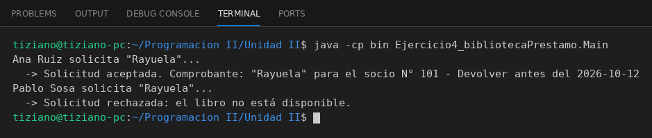

# Biblioteca

Programación II - Unidad 2 - Ejercicio 4

## Consigna
Un socio solicita un libro a la biblioteca y recibe un comprobante si el préstamo fue aceptado o null si fue rechazado.

## Lógica
- `Libro` (título, autor, disponibilidad) y `Socio` (nombre, número de socio).
- `Biblioteca.prestarLibro(libro, socio)`: si el libro está disponible lo marca como no disponible y retorna un `ComprobantePrestamo` (con fecha de devolución a 14 días); si no, retorna `null`.
- `Socio.solicitarPrestamo(...)` envía la solicitud a la biblioteca e interpreta la respuesta (comunicación bidireccional).
- `Main`: un préstamo exitoso y uno fallido sobre el mismo libro.

## Ejecución

